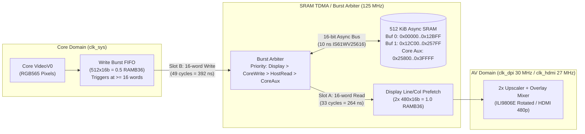

# Game Bub Core Framework — Notes & Upstream Proposals (`Option B` SRAM Display Buffering)

While implementing `GameBub.N64` (`MIRLO64` on `XC7A100TCSG324-1`) against the **unmodified** [`gamebub/framework`](https://github.com/gamebub/framework) (`HEAD`), we recorded small upstream packaging observations and a complete hardware specification for **Option B: Async-SRAM-Backed Display Framebuffering** (`VideoV0` freeing up to **`75.0` `RAMB36E1`s** — `55.6%` of the Artix-7 100T's Block RAM!).

---

## 1. What Worked Out-of-the-Box in `gamebub/framework`

1. **`ram_decomp power` on `HandheldTop` Framebuffers (`common.xdc`):**
   - `VideoV0(320, 240, 6, 6, 6)` (`76,800 × 18-bit`) synthesized to **exactly `75.0` `RAMB36E1`s** (`81.5 / 135` total framework BRAMs including `overlayFramebuffer` and `SpiReceiverFifo`), leaving **`53.5` `RAMB36E1`s** (`240` DSPs and `60K` LUTs) for the N64 core without touching a single line of `framework/`.
2. **`InputExtendedV0(numSlots = 4)` & `VibrateV0`:**
   - The `DeviceType` enum (`0=None, 1=Handheld, 2=DigitalGamepad, 3=AnalogGamepad`) and signed 8-bit axis conventions mapped cleanly onto 4-player N64 Joybus controllers, analog triggers, handheld C-button/walk modifiers, and Rumble Pak haptic feedback (automatically suppressed by `HandheldTop.scala` when docked or unfocused).
3. **On-Demand SD File Commands (`HostV0` `0x0400..0x0404`):**
   - `FileGetSize`, `FileRead`, `FileWrite`, and `FileFlush` on `on_demand: true` files enable full `64 MiB` N64 ROM paging (`Resident Evil 2`, `Conker's Bad Fur Day`, `Pokemon Stadium 2`) while keeping `52 MiB` resident in the dual `W9825G6KH-6` SDRAMs.

---

## 2. Small Framework Enhancement Applied & Upstream Packaging Note (`framework/`)

To keep upstream `MIRLO64` RTL unmodified wherever possible, we made **one small file-discovery enhancement** in `framework/` (on detached `HEAD`) and noted one optional Python dependency improvement for upstream:

1. **Applied in `framework/scripts/build_core.py` — Support Verilog Include (`.vh`/`.svh`) and Memory Init (`.hex`/`.mem`) Files ([build_core.py](file:///usr/local/google/home/elipsitz/Downloads/gamebub-n64/framework/scripts/build_core.py#L141-L159)):**
   - Upstream `build_core.py` filtered `additional_file_dirs` to `{".xdc", ".v", ".sv", ".vhdl"}` only, skipping `.vh`, `.svh`, `.hex`, and `.mem` files. We registered `.vh`/`.svh` (`file_type="verilogSource"` / `"systemVerilogSource"`, `is_include_file=True`) and `.hex`/`.mem` (`file_type="mem"`, mapped by Edalize to Vivado `read_mem`) so `MIRLO64`'s `$readmemh("rsp_div_rom.hex", ...)`, `$readmemh("boot.hex", ...)`, and `` `include "mirlo_regs.svh" `` synthesize directly without modifying `MIRLO64`.
2. **Optional Upstream Note — Include `heatshrink2` in `pyBuildCore.pythonDeps` ([package.mill](file:///usr/local/google/home/elipsitz/Downloads/gamebub-n64/framework/package.mill#L66)):**
   - [build_core.py](file:///usr/local/google/home/elipsitz/Downloads/gamebub-n64/framework/scripts/build_core.py#L201-L208) attempts `import heatshrink2` to emit compressed `.bit.hs` bitstreams (`window_sz2=9, lookahead_sz2=6`), silently skipping compression on `ImportError`, while `pyBuildCore.pythonDeps` currently lists only `Seq("edalize==0.6.7")`. Adding `"heatshrink2"` enables automatic `.bit.hs` generation inside Mill's isolated Python venv (our `tools/package_dist.py` also generates `.bit.hs` directly).

---

## 3. Upstream Feature Proposal: Option B — Async-SRAM-Backed `HandheldTop` Framebuffer

### 3.1 Motivation
On `XC7A100TCSG324-1` (`135` `RAMB36E1` tiles = `607.5 KiB` total on-chip Block RAM):
- A `320×240` double-buffered `RGB666`/`RGB555` `HandheldTop` consumes **`75.0` `RAMB36E1`s (`55.6%` of the FPGA)**.
- Native `640×240` (`2× 153,600 × 18b`) or `640×480` cannot fit in on-chip BRAM at all (`> 150`–`300` `RAMB36E1`s).
- Meanwhile, Game Bub Rev4 carries an **`ISSI IS61WV25616EDBLL-10TLI`** (`512 KiB = 262,144 × 16-bit`, **`10 ns` `tAA`/`tWC`**) asynchronous SRAM that many 5th-gen / arcade / computer cores do not need if SDRAM is already `64 MiB`, OR only need a fraction of (`64–192 KiB`).

Adding an optional `framebufferStorage = FramebufferStorage.Sram` mode to `HandheldTop` (for cores that do not claim `SramV0`, or that share `SramV0` via a framework-provided `SramAuxV0` sub-window):
1. **Frees `73.0` of the `75.0` `RAMB36E1`s** (replacing the two `76,800 × 18b` BRAM framebuffers with `2.0` `RAMB36E1`s of scanline/column burst FIFOs), nearly **doubling** core-available BRAM from `53.5` to **`126.5` `RAMB36E1`s**!
2. Enables **higher-resolution core video modes** such as **`320×240` `RGB565`** (`300 KiB` double-buffered in SRAM, leaving **`212 KiB` of SRAM** still usable by the core!), **`400×240` widescreen**, or **`640×240` native N64 hi-res horizontal** (`300 KiB` single + `150 KiB` rolling half-buffer = `450 KiB` in `512 KiB` SRAM!).

---

### 3.2 `IS61WV25616EDBLL-10TLI` Timing & Bus Turnaround Physics

From the `IS61WV25616EDBLL-10TLI` (`3.3V` `-10`) datasheet:
| Parameter | Symbol | Spec | Implication |
| :--- | :--- | :--- | :--- |
| Read Cycle / Address Access Time | `tRC` / `tAA` | **`10 ns` max** | Back-to-back reads (`CE#=0, OE#=0, WE#=1`) can stream **1 word (`16 bits`) every `10–12.5 ns`** (`80–100 MWords/s = 160–200 MB/s`) just by changing `sram_a[17:0]`! |
| Write Cycle Time / `WE#` Pulse | `tWC` / `tWP` | **`10 ns` / `7 ns` min** | Back-to-back writes require **`WE#` to return high (`tHA >= 0 ns`) before `sram_a[17:0]` changes** to prevent write-glitching adjacent addresses! |
| `OE#` High to Output High-Z | `tHZOE` | **`4 ns` max** | Before FPGA drives `sram_io` (`dataDir=1`) after a Read burst, wait 1 dead cycle after raising `OE#=1` so FPGA and SRAM never fight on `sram_io`. |
| `WE#` Low to Output High-Z | `tHZWE` | **`5 ns` max** | Keeping `OE#=1` during the entire Write burst avoids `tHZWE` completely. |

> [!IMPORTANT]
> **Why Word-by-Word Interleaving Fails — and Burst Interleaving Wins:**
> Switching Read -> Write -> Read on every single pixel wastes cycles on `OE#` turnaround (`tHZOE`) AND `WE#` framing (`setup -> WE# low -> hold`). Instead, buffering **16-pixel bursts** in tiny BRAM/LUTRAM FIFOs amortizes bus turnaround over 16 words, achieving **`> 85%` raw SRAM bus utilization** with zero glitch risk!

---

### 3.3 Cycle-Accurate Interleaving Architecture (`sram_fb_arbiter`)

Run the SRAM controller on a **`100 MHz` (`10.0 ns`) or `125 MHz` (`8.0 ns`) clock** (`clk_sram`, e.g., `125 MHz` `clk_sys2x`):
- **Back-to-back Read Burst (`16` words):** `OE#=0, WE#=1, dataDir=0`, hold each `sram_a` for `2` `clk_sram` cycles (`16.0 ns` vs `10.0 ns` `tAA` -> `+6.0 ns` margin covering FPGA `Tcko` + PCB trace + `Tsu`!). **`16` pixels read in `32` `clk_sram` cycles (`256 ns` = `125 MB/s`)**.
- **Back-to-back Write Burst (`16` words):** `OE#=1, dataDir=1`, `3` `clk_sram` cycles (`24.0 ns`) per word:
  - Cycle `0` (`8 ns`): set `sram_a[17:0]` & `sram_dataOut[15:0]` while `WE#=1` (`8 ns` address setup!).
  - Cycles `1..2` (`16 ns` vs `7 ns` `tWP`!): assert `WE#=0` with `sram_a` & `sram_dataOut` held steady, rising `WE#=1` on the end of cycle `2` while `sram_a` holds until the next cycle `0` (`0` address-hold hazard!).
  - **`16` pixels written in `48` `clk_sram` cycles (`384 ns` = `83.3 MB/s`)** + `1` turnaround cycle (`8 ns`).

### 3.4 Worst-Case Bandwidth Proof (Simultaneous Display Read + Core Write)

Consider `320×240` `RGB565` @ `60 Hz`:
1. **Core Video Write Demand:**
   - Peak line rate (`320` pixels in `51.2 µs` active scanline = `6.25 MPix/s`):
   - `20` bursts of `16` pixels per scanline × `392 ns`/burst = **`7.84 µs` out of `63.5 µs` (`12.3%` of SRAM bus time!)**.
2. **Display Read Demand (Both Unrotated HDMI `720×480` AND Rotated LCD `480×800`):**
   - **HDMI (`720×480p` @ `27.027 MHz`, `2×` vertical + `2×` horizontal scale):**
     - Each `320`-pixel source row is displayed across **two** `31.77 µs` HDMI lines, and prefetched **once** into the `1.0 RAMB36E1` ping-pong line buffer (`20` bursts × `264 ns` = **`5.28 µs` every `63.55 µs` = `8.3%` of SRAM bus time!**).
   - **Rev4 Internal LCD (`ILI9806E`, `displayRotate = true`):**
     - Because the portrait LCD scans columns (`Y = 239..0` along each vertical sweep, `2×` scaled), consecutive reads step by `-320` addresses (`stride = 320`), which is **just as fast (`16 ns`/word!) in asynchronous SRAM as sequential reads** because async SRAM has **zero row-activation (`tRP`/`tRCD`) penalty**! (This is a huge advantage of async SRAM over SDRAM for rotated handheld panels!)
     - Even fetching every rotated `240`-pixel column without reuse across `640` output columns takes `15` bursts × `264 ns` = **`3.96 µs` per LCD column line** (`~18%` of SRAM bus time; `9%` if reusing each fetched `240`-pixel column twice across the `2×` horizontal scale!).
3. **Total Combined SRAM Bus Utilization:**
   - `12.3%` (Core Write) + `18.0%` (Worst-Case Rotated Display Read) = **`30.3%` total SRAM utilization**, leaving **`69.7%` (`> 65 MB/s`)** of free SRAM bandwidth AND **`212 KiB` (`0x25800..0x3FFFF`)** of unused SRAM capacity available to the core via a shared `SramAuxV0` interface!
   - Maximum display FIFO latency jitter when a `16`-word Core Write burst just started is **bounded to `392 ns` (`< 12` `clk_dpi` pixels)**, which a `32`-pixel skid threshold in the `480`-pixel prefetch buffer absorbs with **> 10× safety margin** and zero underflow!
